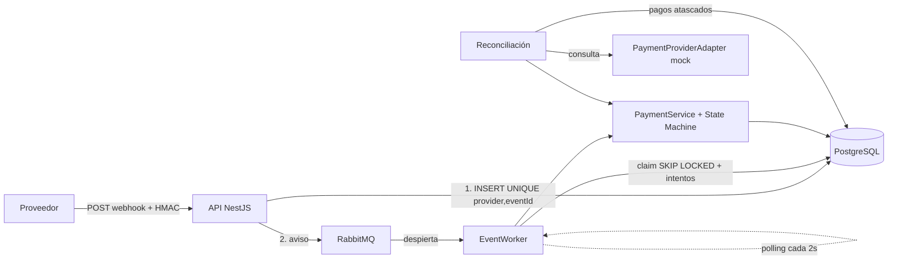

# payment-reconciliation-engine
sistema de reconciliación y actualización de estados de pagos realizados por proveedores externos.

## Problema

Los proveedores de pago notifican cambios de estado con webhooks que pueden repetirse, llegar fuera de orden, perderse o fallar a mitad del procesamiento. Este backend (NestJS + PostgreSQL + Prisma + RabbitMQ) recibe, registra, procesa, audita y reconcilia esos eventos sin duplicar efectos ni perder información.

## Ejecución

```bash
cp .env.example .env            # completar WEBHOOK_SECRET y ADMIN_API_KEY
docker compose up -d            # PostgreSQL + RabbitMQ
pnpm install
pnpm prisma:generate
pnpm prisma:deploy              # aplica las migraciones
pnpm start:dev
```

Tests (los e2e usan la BD de `DATABASE_URL` y borran solo los datos que ellos crean, prefijo `e2e-`):

```bash
pnpm test        # unitarios
pnpm test:e2e    # integración contra PostgreSQL real
```

Para firmar un webhook de prueba: `pnpm build` y luego
`node --env-file=.env dist/webhooks/signature.js '<cuerpo JSON exacto>'`; el resultado va en el header `x-webhook-signature`.

## Endpoints

Todos bajo el prefijo `/api`.

| Método | Ruta | Descripción |
| --- | --- | --- |
| POST | `/webhooks/:provider` | Valida firma HMAC y payload, guarda el evento y responde `202` (`ACCEPTED` o `DUPLICATE`). |
| GET | `/payments/:id` | Estado actual del pago. |
| GET | `/events/:id` | Estado del evento, intentos y errores. |
| POST | `/admin/reconciliation/run` | Ejecuta la reconciliación (header `x-admin-key`). |
| GET | `/health` | Estado de PostgreSQL y RabbitMQ (`503` si alguno falla). |
| GET | `/metrics` | Métricas en formato Prometheus. |

Cada request recibe (o conserva) un `x-correlation-id`, que se guarda con el evento y aparece en todos los logs de su procesamiento.

## Arquitectura



Flujo de un evento: `RECEIVED → PROCESSING → PROCESSED`; con fallo `PROCESSING → RETRY_PENDING → PROCESSING`; al agotar intentos (o ante un error permanente) `DEAD_LETTER`; estados de pago desconocidos terminan en `NEEDS_REVIEW`.

Estructura: `webhooks/` (recepción), `processing/` (cola, worker, reintentos), `payments/` (dominio y máquina de estados), `providers/` (adapters), `reconciliation/`, `metrics/`, `health/`.

### Patrones usados

- **Adapter** (`providers/`): el dominio solo conoce `PaymentProviderAdapter`; cada proveedor trae su adapter. Hoy hay uno simulado.
- **State Machine** (`payments/payment-state-machine.ts`): las transiciones válidas viven en una tabla; `COMPLETED` y `FAILED` son finales.
- **Strategy** (`processing/retry-policy.ts`): la política de reintentos es intercambiable (hoy backoff exponencial).
- **Repository**: `WebhookRepository`, `PaymentRepository` y `EventQueueRepository` aíslan Prisma/SQL de la lógica de negocio.

## Decisiones y trade-offs

- **Idempotencia**: `UNIQUE(provider, eventId)`. Si dos requests llegan a la vez, una inserta y las demás reciben el conflicto y responden `DUPLICATE` sin republicar. `eventId` (notificación) y `paymentId` (pago) son conceptos distintos: un pago tiene muchos eventos.
- **Cola**: la fuente de verdad es PostgreSQL (`Webhooks_Events`). RabbitMQ solo despierta al worker; si el aviso se pierde, el polling recoge el evento. Así no existe un estado en el que un evento guardado nunca se procese.
- **Claim atómico**: un solo `UPDATE ... WHERE id IN (SELECT ... FOR UPDATE SKIP LOCKED)` reclama eventos e inserta el intento. `nextRetryAt` hace de *lease*: si un worker muere con el evento en `PROCESSING`, vuelve a ser elegible al vencer `WORKER_LEASE_MS`.
- **Concurrencia limitada**: cada lote reclama como máximo `WORKER_CONCURRENCY` eventos y se espera con `Promise.allSettled` antes del siguiente.
- **Orden de eventos**: se compara `occurredAt` del evento con `lastEventAt` del pago; solo avanza si es más nuevo **y** la transición es válida. La actualización es optimista (`WHERE lastEventAt = <leído>`); si otro proceso se adelantó se lanza un error transitorio y se reintenta.
- **Estados desconocidos** (p. ej. `REFUNDED`): el evento queda en `NEEDS_REVIEW` con su payload original y el pago no se toca.
- **Errores**: validación (`400`, nunca se guarda), transitorios (`TransientError` y cualquier error inesperado: reintento con backoff) y permanentes (`PermanentError`: directo a `DEAD_LETTER`).
- **Payload original**: se guarda en `rawPayload` (JSONB) ya filtrado por el DTO. Hoy no contiene datos sensibles; si el proveedor enviara datos de tarjeta habría que enmascararlos antes de guardar.
- **Secretos**: `WEBHOOK_SECRET` y `ADMIN_API_KEY` solo por variables de entorno.

### Reconciliación

`POST /admin/reconciliation/run` busca pagos en `PENDING`/`PROCESSING` sin cambios en `RECONCILIATION_STUCK_AFTER_MS`, consulta el adapter, registra la discrepancia en el log (`reconciliation.discrepancy`) y aplica la corrección por el mismo camino idempotente que los webhooks. Ejecutarlo varias veces no repite efectos: un pago corregido sale del conjunto de atascados. Devuelve `{ checked, inSync, corrected, unresolved, failed }`.

## Observabilidad

Logs en JSON con `timestamp`, `level`, `context`, `eventId`, `paymentId`, `provider`, `attempt` y `correlationId`; no se registran secretos ni payloads.

Métricas (`/api/metrics`): `webhook_events_received_total`, `webhook_events_duplicated_total`, `webhook_events_processed_total{outcome}`, `webhook_events_failed_total`, `webhook_events_retried_total`, `webhook_events_dead_letter_total`, `webhook_event_processing_duration_seconds`, más las de Node (`process_cpu_*`, `process_resident_memory_bytes`, `nodejs_eventloop_lag_*`, `nodejs_active_*`).

### Alertas

| Alerta | Condición | Severidad | Acción |
| --- | --- | --- | --- |
| Eventos en DLQ | `increase(webhook_events_dead_letter_total[5m]) > 0` | Alta | Buscar el evento con `status = 'DEAD_LETTER'` y leer `lastError` y sus intentos en `GET /events/:id`. Si es una caída del proveedor o un bug ya corregido, volver el evento a `RETRY_PENDING` (se reintenta una vez más porque el contador de intentos se conserva para auditoría). |
| Tasa de fallos alta | `increase(webhook_events_failed_total[5m]) / (increase(webhook_events_processed_total[5m]) + increase(webhook_events_failed_total[5m])) > 0.2` | Media | Filtrar los logs `event.failed` por `error` y `provider`; confirmar si es un solo proveedor, la BD (`/health`) o un error de código tras un despliegue. |
| Worker detenido | `rate(webhook_events_received_total[10m]) > 0 and rate(webhook_events_processed_total[10m]) == 0` | Crítica | Revisar logs `worker.drain_failed`, `/health` y si el proceso sigue vivo; luego eventos en `PROCESSING` con `nextRetryAt` vencido (leases sin liberar). |

## Mapeo a AWS (no desplegado)

| Local | AWS | Problema que resuelve |
| --- | --- | --- |
| API NestJS | ECS/Fargate (API Gateway como entrada) | Escalado y entrada administrada. |
| Cola en PostgreSQL + RabbitMQ | SQS con DLQ | Desacopla recepción y procesamiento; `maxReceiveCount` reemplaza al contador de intentos y la DLQ a `DEAD_LETTER`. |
| PostgreSQL (Docker) | RDS for PostgreSQL | Pagos, inbox de eventos y auditoría con backups. |
| Logs JSON / `/metrics` | CloudWatch Logs, Metrics y Alarms | Búsqueda por `correlationId` y alertas. |
| `.env` | Secrets Manager | Rotación de `WEBHOOK_SECRET`. |
| `POST /admin/reconciliation/run` | EventBridge Scheduler | Ejecución periódica de la reconciliación. |
| Credenciales | IAM Roles | Permisos mínimos por servicio. |

Migrar a SQS: la API haría `SendMessage` con el `id` del evento tras el `INSERT` (la tabla seguiría siendo el inbox idempotente) y el worker consumiría de SQS en lugar de reclamar con SQL; `EventQueueRepository` es la costura que se reemplaza.

## Limitaciones conocidas

- La cola en SQL se consulta por polling; con mucho volumen convendría particionar o usar SQS.
- El worker corre dentro de la API; en producción sería un proceso separado escalable aparte.
- El adapter del proveedor es simulado y la regla "más reciente" depende de `occurredAt` (si el proveedor ofrece una secuencia por pago sería más fiable).
- Un `DEAD_LETTER` se reabre a mano; falta un endpoint administrativo para reprocesar.
- Las discrepancias se registran en logs, no en una tabla.
- Si un evento se inserta justo cuando el worker termina de vaciar la cola, espera hasta el siguiente ciclo de polling.
- Los tests e2e usan la base de desarrollo en lugar de una base aislada.

## Demo (5 minutos)

1. Webhook `COMPLETED` válido → `202`, luego `GET /events/:id` y `GET /payments/:id`.
2. Mismo `eventId` otra vez → `DUPLICATE`, un solo evento en BD.
3. Webhook `PENDING` con `occurredAt` anterior → evento `PROCESSED` con outcome `IGNORED`, el pago sigue `COMPLETED`.
4. Fallos: `pnpm test event-processor` muestra el retry con backoff tras un fallo transitorio y el paso a `DEAD_LETTER` al agotar intentos; con `MOCK_PROVIDER_FAILURE_RATE=1` la reconciliación reporta `failed` sin abortar.
5. Reconciliación sobre un pago atascado, ejecutada dos veces.

Conceptos de JavaScript/TypeScript del reto: ver [docs/js-ts-concepts.md](docs/js-ts-concepts.md).

